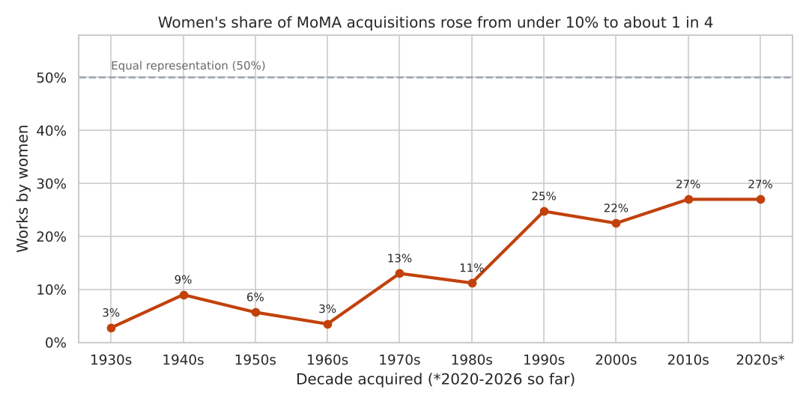
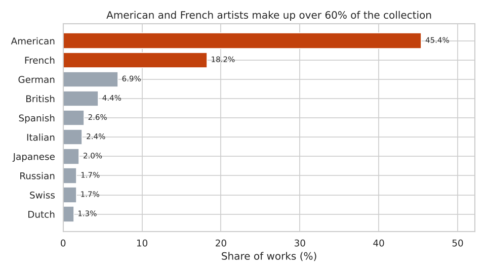
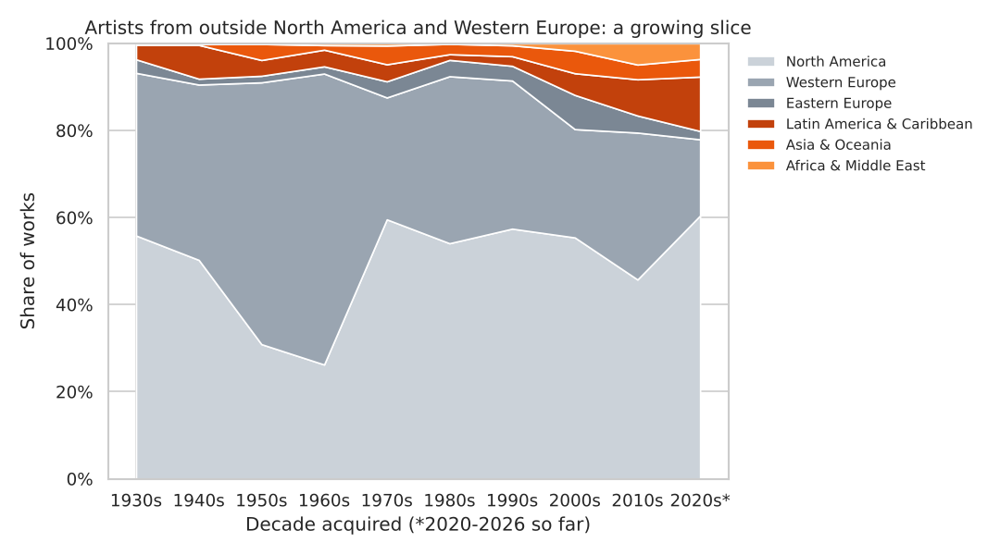
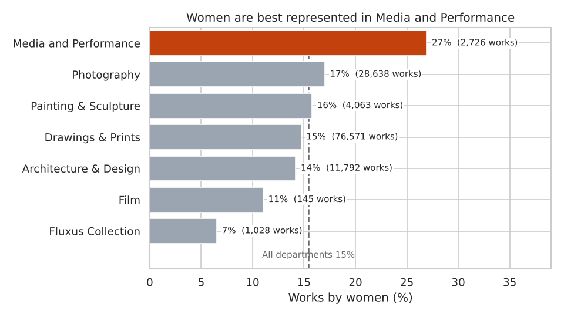
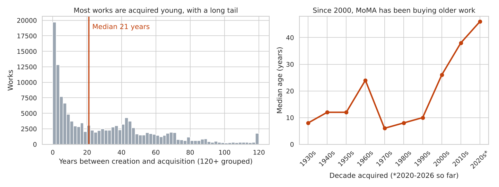
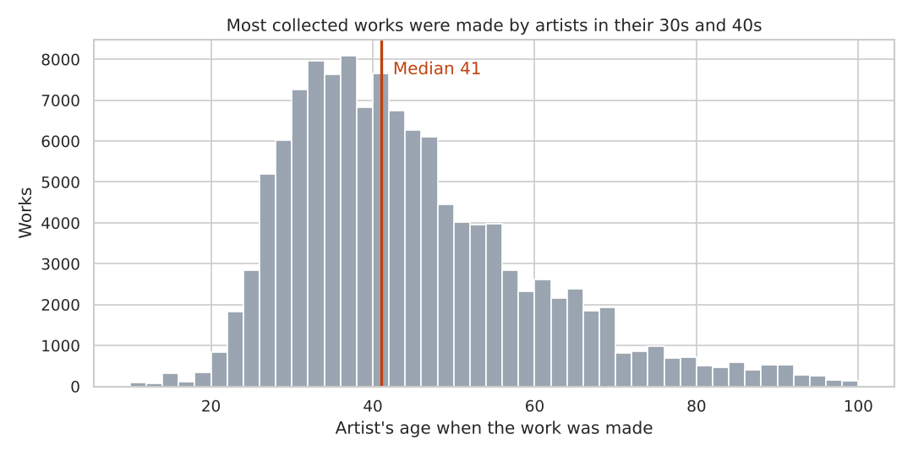

# Who Gets Into MoMA?

An analysis of diversity in the Museum of Modern Art's collection, 1929–2026. The project cleans MoMA's own collection data (160,928 artworks) and measures how representation of **women artists** and **artists from different parts of the world** has changed over almost a century of acquisitions.

**Tools:** Python · pandas · matplotlib · seaborn

## Dataset

[MoMA Collection](https://github.com/MuseumofModernArt/collection): MoMA's official data on GitHub, released under CC0 (public domain). One row per catalogued artwork, with artist, gender, nationality, birth year, creation date, medium, department and acquisition date.

`data/raw/Artworks.csv.gz` is MoMA's `Artworks.csv`, trimmed to the 18 columns this project uses and compressed (73 MB → 7 MB) so it fits on GitHub. The values themselves are unchanged and still raw.

## Questions

1. What share of the collection is by women, and how has that changed?
2. Which nationalities dominate, and is the collection becoming more global?
3. Does representation of women differ by department?
4. How old is a work when MoMA acquires it?
5. How old are artists when they make the works MoMA collects?

## Data cleaning

| Problem in the raw data | How it was handled |
|---|---|
| ~17,000 drawings from one architect (Mies van der Rohe Archive) | Removed, so one person doesn't dominate the counts |
| Works with no artist (1,256) or no acquisition date (2,684) | Removed |
| Artist fields wrapped in brackets: `(male)`, `(American)`, `(1887)` | Brackets stripped |
| Creation dates as free text: `c. 1910`, `1961-72`, `June 1946`, `(2004)`, `n.d.` | Took the first 4-digit year (found for 98.3% of works) |
| Unknown birth years written as `(0)` | Treated as missing, not as year 0 |
| 5.5% of works list several artists in one cell | Gender and nationality questions use single-artist works only |
| Rare and inconsistent gender labels (`female (transwoman`, `woman, non-binary`…) | Mapped by hand to Male / Female / Non-binary / Unknown |
| 139 nationalities | Grouped into 6 world regions |
| 95 works "made" after MoMA acquired them | Creation year set to missing |
| Artist ages under 10 or over 100 when the work was made | Set to missing (bad birth or creation year) |

Final dataset: **139,896 artworks**.

## Key findings

**1. Women are still a minority, but their share has grown.** Women made 15.4% of the works (20.1% of the artists). Before 1970, fewer than 10% of each decade's acquisitions were by women. Since the 2010s it has been 27%.



**2. The collection is mostly American and French.** Those two nationalities account for 63.6% of works. Artists from outside North America and Western Europe made up under 10% of acquisitions until the 1990s, and about 20–22% since 2000.




**3. Media and Performance is the most balanced department** (27% women). The Fluxus Collection (7%) and Film (11%) are the least balanced.



**4. MoMA has shifted from buying new art to catching up on history.** The median work was 21 years old when acquired. In the 1970s–1990s the median was 6–10 years, but in the 2020s it is 46 years, which suggests the museum is filling historical gaps.



**5. Collected works are usually made by artists in their late 30s to early 40s** (median 41, almost the same for women and men).



## Limitations

- Counts are by **number of works**, not importance or gallery space. One prolific photographer can add hundreds of works.
- Gender and nationality are as recorded by MoMA, and nationality is not the same as where an artist lived or worked.
- The 2020s cover 2020–2026 only.

## Project structure

```
moma-collection-analysis/
├── data/raw/Artworks.csv.gz   # MoMA collection data (18 columns, compressed)
├── data_cleaning.py           # step 1: cleaning
├── analysis.py                # step 2: the five questions + charts
├── main.py                    # runs both steps
├── images/                    # charts
└── requirements.txt
```

## How to run (PyCharm)

1. **File → Open** and select the project folder.
2. Create a virtual environment and install `requirements.txt`, or run `pip install -r requirements.txt` in the terminal.
3. Open `main.py` and click **Run** ▶. It takes about 15 seconds.

The results print in the Run console, the charts are saved to `images/`, and the cleaned data goes to `data/processed/`.
